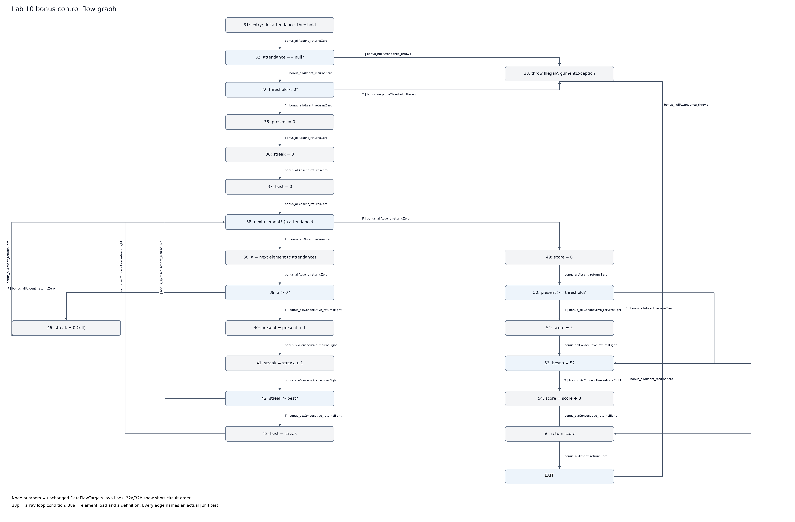

# Лаборатори 10 Өгөгдлийн урсгал ба DU хосууд

Оюутны нэр: **Н. Төгөлдөр**  
Оюутны код: **B232270009**  
Хичээл: **F.CSA313 Программ хангамжийн чанарын баталгаа ба тест**

`java -version` командын бүтэн гаралт:

```text
openjdk version "21.0.13" 2026-10-20
OpenJDK Runtime Environment (build 21.0.13+9-1-deb13u2-Debian)
OpenJDK 64-Bit Server VM (build 21.0.13+9-1-deb13u2-Debian, mixed mode, sharing)
```

`mvn -version` командын бүтэн гаралт (`-B -Dstyle.color=never` нь өнгөгүй гаралт авна):

```text
Apache Maven 3.9.9
Maven home: /usr/share/maven
Java version: 21.0.13, vendor: Debian, runtime: /usr/lib/jvm/java-21-openjdk-amd64
Default locale: en, platform encoding: UTF-8
OS name: "linux", version: "6.12.115+deb13.1-amd64", arch: "amd64", family: "unix"
```

Хоёр функцийн definition–use холбоог эх файлын мөрөөр шинжилж, JUnit 5
тестээр гаралтыг шалгасан. Эцсийн 13 тест амжилттай, JaCoCo Branch 16/16,
Line 23/24; үлдсэн нэг мөр нь 7-р мөрийн далд constructor юм.
`src/main` дахь код starter-тэй байт бүрээрээ ижил.

## Хэмжилтийн дүрэм

DU хосыг `(хувьсагч, def мөр, use мөр, c/p төрөл)` гэж тоолсон.
`c-use` нь тооцоолол болон return-д унших, `p-use` нь шийдвэрт унших явдал.
Use-д хүрэх хүртэл тухайн хувьсагч дахин тодорхойлогдоогүй бол зам def-clear.
`v = v + 1` мөрийн баруун талын use нь зүүн талын def-ээс өмнө явагдана;
өөртөө буцсан DU хос нь өөр өөр давталтын гүйцэтгэлүүдийг холбоно.
Блок төгсгөх хаалт, тайлбар, зөвхөн зарласан боловч утга оноогоогүй `tmp`
нь def/use зангилаа биш. Давталтын нуугдмал индексийг эх кодын хувьсагчдын
DU тоонд оруулаагүй.

32-р мөрийн `||`-ийг `32a` (`attendance == null`), `32b` (`threshold < 0`)
гэж салгасан. 38-р мөрийг `38p` (дараагийн элемент байгаа эсэх, attendance-ийн
p-use), `38a` (массивын дараагийн элементийг уншиж a-д оноох) гэж салгасан.
Массивын элемент авах attendance-ийн c-use-г `38a` дээр ил тод тооцсон.
Ингэснээр bonus-ийн хүснэгт 24 хостой; элемент уншихыг тусад нь тооцдоггүй
конвенцоор attendance 31→38a-г хасвал 23 хос болно. Доорх бүх хүснэгт,
CFG, шалгах скрипт ижил 24 хосын конвенц хэрэглэнэ.

Хүснэгтийн зам нь тухайн ID-тай тестүүдийн ядаж нэгийн бодит оролтод
биелэх гэрч зам; бусад ID мөн уг хосыг хамарна. p-use-ийн T/F салааг
нэмэлт хүснэгтэд тусад нь баталгаажуулсан.

## A gcd функц

| ID | Бодит тестийн метод | Оролт | Хүлээх утга |
|---|---|---|---:|
| G1 | `gcd_twoIterations_returnsFour` | (12, 8) | 4 |
| G2 | `gcd_zeroDivisor_returnsSeven` | (7, 0) | 7 |
| G3 | `gcd_zeroDividend_returnsFive` | (0, 5) | 5 |

| Хувьсагч | Def мөр | Use мөр | Төрөл | Def-clear зам | Тестийн ID | Хамрагдсан |
|---|---|---|---|---|---|---|
| tmp | 16 | 18 | c-use | 16 → 17 → 18 | G1, G3 | Тийм |
| x | 13 | 16 | c-use | 13 → 15 → 16 | G1, G3 | Тийм |
| x | 13 | 20 | c-use | 13 → 15 → 20 | G2 | Тийм |
| x | 17 | 16 | c-use | 17 → 18 → 15 → 16 | G1 | Тийм |
| x | 17 | 20 | c-use | 17 → 18 → 15 → 20 | G1, G3 | Тийм |
| y | 13 | 15 | p-use | 13 → 15 | G1, G2, G3 | Тийм |
| y | 13 | 16 | c-use | 13 → 15 → 16 | G1, G3 | Тийм |
| y | 13 | 17 | c-use | 13 → 15 → 16 → 17 | G1, G3 | Тийм |
| y | 18 | 15 | p-use | 18 → 15 | G1, G3 | Тийм |
| y | 18 | 16 | c-use | 18 → 15 → 16 | G1 | Тийм |
| y | 18 | 17 | c-use | 18 → 15 → 16 → 17 | G1 | Тийм |

Нийт 11 DU хос. `gcd(7,0)` нь энэ багцад x-ийн **13→20** хосыг
ганцаараа хамарна: давталт огт ажиллахгүй тул x-ийн анхны def return-д хүрнэ.
Мөн y-ийн 13→15 хосын F салааг хамарна. `gcd(12,8)` яг хоёр давталттай:
эхлээд `(x,y,tmp)=(8,4,4)`, дараа нь `(4,0,0)` болно.
x 17→16, y 18→16, y 18→17 болон y 18→15-ийн T салаанд хүрэхэд
хоёр дахь давталт шаардлагатай. `tmp`-ийн 14-р мөрийн зарлалд утга
оноогоогүй; def нь 16, use нь 18. 17-р мөр x-ийн 13 болон өмнөх
17-р мөрийн def-ийг, 18-р мөр y-ийн 13 болон өмнөх 18-р мөрийн def-ийг kill хийнэ.

| Хувьсагч ба p-use | T салааг дайрах тест | F салааг дайрах тест |
|---|---|---|
| y 13→15 | G1, G3 | G2 |
| y 18→15 | G1 | G1, G3 |

## B bonus функцийн анализ

### B1 Удирдлагын урсгалын граф



Зангилааны дугаар нь DataFlowTargets.java файлын мөр. Бүх ирмэгийн шошгонд
тухайн ирмэгийг дайрдаг **бодит тестийн методын нэр** бий. 32-р мөрийн
богино холболтыг тусад нь үзүүлсэн: attendance null бол threshold-ийн
нөхцөлийг үнэлэхгүй. 38p-ийн T салаа 38a-д, F салаа давталтын дараах 49-д
очино. 42-ийн F салаа, 43 болон 46-аас буцсан замууд дараагийн элемент
шалгах 38p-д очно. Зургийг дахин үүсгэх эх нь [draw_cfg.py](scripts/draw_cfg.py).

### B2 Мөр бүрийн def ба use

```text
31  def attendance, threshold  // параметрүүд
32a p-use attendance          // attendance == null
32b p-use threshold           // зүүн операнд false үед л үнэлнэ
33  def/use байхгүй           // exception шидээд гарна
35  def present
36  def streak
37  def best
38p p-use attendance          // дараагийн элемент байгаа эсэх
38a c-use attendance; def a   // дараагийн элементийг ачаалж онооно
39  p-use a
40  c-use present; def present // use нь шинэ def-ээс өмнө
41  c-use streak; def streak   // use нь шинэ def-ээс өмнө
42  p-use streak, best
43  c-use streak; def best
46  def streak               // өмнөх утгыг уншихгүй; reset kill
49  def score
50  p-use present, threshold
51  def score
53  p-use best
54  c-use score; def score
56  c-use score
```

### B3 DU хүснэгт ба kill

| Хувьсагч | Def мөр | Use мөр | Төрөл | Def-clear зам | Тестийн ID | Хамрагдсан |
|---|---|---|---|---|---|---|
| a | 38a | 39 | p-use | 38a → 39 | B1, B2, B5, B6, B7, B10 | Тийм |
| attendance | 31 | 32a | p-use | 31 → 32a | B1, B2, B3, B4, B5, B6, B7, B8, B9, B10 | Тийм |
| attendance | 31 | 38a | c-use | 31 → 32a → 32b → 35 → 36 → 37 → 38p → 38a | B1, B2, B5, B6, B7, B10 | Тийм |
| attendance | 31 | 38p | p-use | 31 → 32a → 32b → 35 → 36 → 37 → 38p | B1, B2, B3, B4, B5, B6, B7, B10 | Тийм |
| best | 37 | 42 | p-use | 37 → 38p → 38a → 39 → 40 → 41 → 42 | B1, B2, B6, B7, B10 | Тийм |
| best | 37 | 53 | p-use | 37 → 38p → 49 → 50 → 53 | B3, B4, B5 | Тийм |
| best | 43 | 42 | p-use | 43 → 38p → 38a → 39 → 40 → 41 → 42 | B1, B2, B7, B10 | Тийм |
| best | 43 | 53 | p-use | 43 → 38p → 49 → 50 → 53 | B1, B2, B6, B7, B10 | Тийм |
| present | 35 | 40 | c-use | 35 → 36 → 37 → 38p → 38a → 39 → 40 | B1, B2, B6, B7, B10 | Тийм |
| present | 35 | 50 | p-use | 35 → 36 → 37 → 38p → 49 → 50 | B3, B4, B5 | Тийм |
| present | 40 | 40 | c-use | 40 → 41 → 42 → 43 → 38p → 38a → 39 → 40 | B1, B2, B7, B10 | Тийм |
| present | 40 | 50 | p-use | 40 → 41 → 42 → 38p → 49 → 50 | B1, B2, B6, B7, B10 | Тийм |
| score | 49 | 54 | c-use | 49 → 50 → 53 → 54 | B1 | Тийм |
| score | 49 | 56 | c-use | 49 → 50 → 53 → 56 | B4, B5 | Тийм |
| score | 51 | 54 | c-use | 51 → 53 → 54 | B2, B10 | Тийм |
| score | 51 | 56 | c-use | 51 → 53 → 56 | B3, B6, B7 | Тийм |
| score | 54 | 56 | c-use | 54 → 56 | B1, B2, B10 | Тийм |
| streak | 36 | 41 | c-use | 36 → 37 → 38p → 38a → 39 → 40 → 41 | B1, B2, B7, B10 | Тийм |
| streak | 41 | 41 | c-use | 41 → 42 → 43 → 38p → 38a → 39 → 40 → 41 | B1, B2, B7, B10 | Тийм |
| streak | 41 | 42 | p-use | 41 → 42 | B1, B2, B6, B7, B10 | Тийм |
| streak | 41 | 43 | c-use | 41 → 42 → 43 | B1, B2, B6, B7, B10 | Тийм |
| streak | 46 | 41 | c-use | 46 → 38p → 38a → 39 → 40 → 41 | B2, B6, B7 | Тийм |
| threshold | 31 | 32b | p-use | 31 → 32a → 32b | B1, B2, B3, B4, B5, B6, B7, B9, B10 | Тийм |
| threshold | 31 | 50 | p-use | 31 → 32a → 32b → 35 → 36 → 37 → 38p → 49 → 50 | B1, B2, B3, B4, B5, B6, B7, B10 | Тийм |

Нийт 24 DU хос. `streak = 0` (46) нь хүрч ирсэн streak-ийн 36, 41 эсвэл
өмнөх давталтын 46-р мөрийн def-ийг kill хийнэ. Жишээлбэл, B2-ийн
эхний таван ирцийн дараах таслалт 41-ийн утгыг устгаж, дараах ирц дээр
**46→41** хос үүсгэнэ; таслалтыг нэвтэлсэн **41→41** зам def-clear биш.
Харин B1-ийн залгаа ирцүүд 41→41-ийн өөр, def-clear замыг хамарна.
B5-ийн эхний таслалт 36-г, дараагийн таслалтууд өмнөх 46-г kill хийнэ.

| Бусад дахин тодорхойлолт | Kill |
|---|---|
| present 40 | өмнөх 35 эсвэл 40-ийн def; баруун тал нь эхлээд хуучин утгыг уншина |
| streak 41 | өмнөх 36, 41, 46-ийн def; баруун талын use-ийн дараа kill болно |
| best 43 | өмнөх 37 эсвэл 43-ийн def |
| a 38a | өмнөх давталтын 38a-ийн def |
| score 51 | 49-ийн def |
| score 54 | 49 эсвэл 51-ийн def; баруун талын use-ийн дараа kill болно |

Дараах def–use хослолууд def-clear замгүй тул DU хосод орохгүй:

| Хасагдсан хослол | Үндэслэл |
|---|---|
| streak 36→42, 36→43 | 42/43 хүрэх эерэг ирц бүрийн өмнө 41 шинэ streak онооно; тасалбал 46 мөн kill хийнэ. |
| streak 46→42, 46→43 | reset-ийн дараа 42/43 хүрэхдээ 41 дээр заавал дахин тодорхойлогдоно. |
| present 35→40-ийн өмнөх 40 дайрсан зам; streak 36/41→41-ийн 46 дайрсан зам | 40/41 хос өөр замаар боломжтой ч present-ийн өмнөх 40, streak-ийн 46 дайрсан замууд тухайн def-ийг kill хийнэ. |
| best 37→42/53-ийн 43 дайрсан зам | 43 дээр best дахин тодорхойлогдох тул 37-ийн def хүрэхгүй. |
| score 49→56-ийн 51 эсвэл 54 дайрсан зам | 51/54 нь 49-ийн утгыг return-ээс өмнө дарна. |
| score 51→56-ийн 54 дайрсан зам | return нь 51 бус, 54-ийн утгыг уншина. |

Энд “хасагдсан зам” нь тухайн мөрийн хосыг бүхэлд нь боломжгүй гэсэн үг
биш: хүснэгтэд буй 35→40, 49→56 зэрэг хосууд kill дайраагүй өөр замтай.

| Хувьсагч ба p-use | T салааны гэрч | F салааны гэрч |
|---|---|---|
| attendance 31→32a | B8 | B1 |
| threshold 31→32b | B9 | B1 |
| attendance 31→38p | B1 | B3; B1-ийн гарах шалгалт |
| a 38a→39 | B1 | B5 |
| present 35→50 | B3 | B4 |
| present 40→50 | B2 | B1 |
| streak 41→42 | B1 | B2-ийн таслалтын дараах ирц |
| best 37→42 | B1 | Биелэшгүй: best анхны 0 хэвээр байхад 42-д хүрэх streak заавал 1 ба түүнээс их. |
| best 43→42 | B1 | B2 |
| best 37→53 | Биелэшгүй: анхны best=0 нь 5-аас бага. | B3, B5 |
| best 43→53 | B1 | B6, B7 |

Дээрх хоёр T/F үл хамаарах салаанаас бусад хүснэгтэд тоолсон бүх хос
биелэх оролтын гэрчтэй. 32b руу attendance=null байх зам биелэшгүй:
`||`-ийн зүүн тал true болмогц баруун талыг алгасана. Энэ нь threshold
31→32b хосыг бүхэлд нь биелэшгүй болгохгүй, B9 дээр хүрч болно.

### B4 Хоёр үеийн тестүүд

| ID | Бодит тестийн метод | attendance | threshold | Хүлээх утга |
|---|---|---|---:|---|
| B1 | `bonus_belowThresholdLongStreak_returnsThree` | [1, 1, 1, 1, 1] | 6 | 3 |
| B2 | `bonus_atThresholdInterruptedLongStreak_returnsEight` | [1, 1, 1, 1, 1, 0, 1] | 6 | 8 |
| B3 | `bonus_emptyZeroThreshold_returnsFive` | [] | 0 | 5 |
| B4 | `bonus_emptyPositiveThreshold_returnsZero` | [] | 1 | 0 |
| B5 | `bonus_allAbsent_returnsZero` | [0, -1, 0] | 1 | 0 |
| B6 | `bonus_initialAbsenceThenPresent_returnsFive` | [0, 1] | 1 | 5 |
| B7 | `bonus_splitFivePresent_returnsFive` | [1, 1, 0, 1, 1, 1] | 5 | 5 |
| B8 | `bonus_nullAttendance_throws` | null | 0 | IllegalArgumentException |
| B9 | `bonus_negativeThreshold_throws` | [] | -1 | IllegalArgumentException |
| B10 | `bonus_sixConsecutive_returnsEight` | [1, 1, 1, 1, 1, 1] | 6 | 8 |

**ALL-DEFS:** B1, B2 гэсэн хамгийн цөөн **2 bonus тест**.
Эхний үеийн нийт тоо нь gcd-ийн 3-тай нийлээд **5 тест**.
B1 дээр score-ийн 49→54, 54→56; B2 дээр 51→54, 54→56 холбоогоор
49, 51, 54 гэсэн def бүр use-д хүрнэ. B2-ийн таслалтаас хойших ирц
46-ийн streak def-ийг 41-ийн use-д хүргэнэ. 13 def цэг бүгд ядаж нэг
use-д хүрснийг [analyze_du.py](scripts/analyze_du.py) загвар дээр тулгана.
Нэг bonus гүйцэтгэлээр хангахгүй: `present >= threshold` true үед 51 нь
49-г kill хийнэ, false үед 51 огт ажиллахгүй. Иймээс score 49 ба 51-ийн
def-ийг use-д хүргэхэд дор хаяж хоёр тусдаа гүйцэтгэл хэрэгтэй; B1/B2
нь энэ доод хязгаарыг хангана. Exception тестүүд all-defs-д шаардлагагүй,
учир нь 33 дээр шинээр утга оноохгүй.

**ALL-DU-PAIRS:** B3–B10-ыг нэмж bonus 10, gcd 3, нийт **13 тест** болсон.
B3/B4 нь эхний present/best-ийн давталтгүй use болон score-ийн шууд return
холбоог, B5 нь таслалт/сөрөг ирцийг, B6 нь эхний reset-ээс дараах update-ийг,
B7 нь богино цуваа тасарч дахин өсөх урсгалыг шалгана. B8/B9 нь оролтын
хоёр хамгаалалт, B10 нь таваас урт залгаа ирцийн заагийг шалгана.
Эцсийн багцыг хамгийн цөөн all-DU багц гэж шаардахгүй; нэмэлт зааг болон
алдаа барих oracle-тай тестүүд орсон. Бүх метод, DisplayName латин үсэгтэй.

### B5 JaCoCo ба DU-ийн ялгаа

| Үе шат | Тест | Branch covered / total | Branch | Line covered / total | Line |
|---|---:|---:|---:|---:|---:|
| ALL-DEFS | 5 | 13/16 | 81.25% | 22/24 | 91.67% |
| Branch 100 боловч DU дутуу туршилт | 8 | 16/16 | 100% | 23/24 | 95.83% |
| Эцсийн ALL-DU-PAIRS | 13 | 16/16 | 100% | 23/24 | 95.83% |

Нотолгоо: [all-defs гаралт](results/mvn-verify-alldefs.txt),
[all-defs CSV](results/jacoco-alldefs.csv),
[Branch 100 туршилтын гаралт](results/mvn-verify-branch100-not-du.txt),
[туршилтын CSV](results/jacoco-branch100-not-du.csv),
[эцсийн гаралт](results/mvn-verify-final.txt),
[эцсийн CSV](results/jacoco-final.csv).
Хувь нь `COVERED / (COVERED + MISSED) * 100`.
ALL-DEFS үеийн `BRANCH_MISSED=3`, `LINE_MISSED=2`: оролтын алдааны 33-р
мөр болон далд constructor хамрагдаагүй. Эцэст `BRANCH_MISSED=0`,
`BRANCH_COVERED=16`, `LINE_MISSED=1`, `LINE_COVERED=23`.
Constructor-ийг хамруулах тусгай тест нэмээгүй.

All-defs нь def бүр ядаж нэг use-д хүрснийг л шаарддаг тул 100% branch
заавал болохгүй. Үүнийг B1/B2-ийн 81.25%-ийн бодит хэмжилт харуулна.
Нөгөө чиглэлийн жишээг мөн **бодитоор ажиллуулсан**: G1–G3 болон
B1, B2, B3, B8, B9 гэсэн нийт 8 тест 16/16 branch хамардаг.
Гэвч score-ийн **49→56** хос дутна: B1 дээр 49-ийн score-г 54 уншаад
дахин тодорхойлно, B2/B3 дээр 51 нь 49-г kill хийнэ, B8/B9 return-д
хүрэхгүй. `50 F` ба `53 F` тус тус хамрагдсан ч нэг гүйцэтгэлд хамт
тохиолдоогүй. B4 эсвэл B5 нь 49→50 F→53 F→56 def-clear замыг нэмж,
уг DU хосыг гүйцээнэ. JaCoCo нь хувьсагчийн def–use холбоог хэмждэггүй.

[analyze_du.py](scripts/analyze_du.py) нь эх кодоос гаргасан CFG ба тестийн
оролтын **тусдаа загвар** дээр def-clear зам, kill, 11/11 болон 24/24 DU
хос, CFG ирмэгийн гэрчийг тулгадаг. Энэ нь production кодод instrumentation
хийсэн динамик DU хэмжигч биш; хүснэгтийн давтагдах шалгалт юм. Бодит Java
гүйцэтгэл, assertion ба branch/line-ийн нотолгоо нь Maven log, JaCoCo CSV.

## C Урсгалын алдаа тарих

Мутаци бүрийг үндсэн DataFlowTargets.java дээр нэг нэгээр нь түр оруулж,
`mvn test` ажиллуулаад **git restore**-оор буцаасан. Мутацитай эх кодыг
commit хийгээгүй. Доорх expected/was мөрүүдийг results-ийн гаралтаас хуулсан.

| Мутаци | Тест / үр дүн | Нотолгооноос хуулсан мөр |
|---|---|---|
| M1 streak update устгах | 13 тестээс 3 унав | `BonusTest.bonus_atThresholdInterruptedLongStreak_returnsEight:18 expected: <8> but was: <5>` |
| M1 | Дээрх 3 уналтын нэг | `BonusTest.bonus_belowThresholdLongStreak_returnsThree:12 expected: <3> but was: <0>` |
| M1 | Дээрх 3 уналтын нэг | `BonusTest.bonus_sixConsecutive_returnsEight:66 expected: <8> but was: <5>` |
| M2 if/best update блокийг best = present болгох | 13 тестээс 1 унав | `BonusTest.bonus_splitFivePresent_returnsFive:48 expected: <5> but was: <8>` |
| M3 давталтын дараа int total = present + best нэмэх | Уналтгүй, амьд | `Tests run: 13, Failures: 0, Errors: 0, Skipped: 0` |

Гаралтууд: [M1](results/mvn-test-M1.txt), [M2](results/mvn-test-M2.txt),
[M3](results/mvn-test-M3.txt). M1/M2 `BUILD FAILURE`, M3 `BUILD SUCCESS`.
M1 нь streak-ийг өсгөх def-ийг алга болгож, best=0 хэвээр үлдээнэ;
урт цувааны нэмэлт 3 оноо өгөхгүй болохыг oracle илрүүлсэн.

M2-ийг B7 **шууд барьсан** тул тусдаа M2-kill дахин ажиллуулах үе шат
шаардлагагүй. B7-ийн `[1,1,0,1,1,1]`, threshold=5 оролтод зөв present=5,
best=3, score=5. Мутаци дээр best нь сүүлийн эерэг өдөр present=5 болж,
score 8 болно. Мутацийг “if (streak > best) { best = streak; }” блокийг
бүхэлд нь `best = present;` болгох гэж хэрэгжүүлсэн. Хэрэв зөвхөн доторх
баруун талыг өөрчилсөн хувилбар байсан ч B7-ийн сүүлийн өдөр streak=3,
өмнөх best=2 тул best=5 болж мөн баригдана. Эхнээсээ тасралтгүй ирэх үед
present ба streak тэнцүү учир B1 зэрэг тест энэ буруу use-ийг ялгаж чадахгүй.
DU хосыг дайрсан байх нь алдаатай утгын нөлөө гаралтад заавал дамжина
гэсэн баталгаа биш; салангид ирцийн oracle хэрэгтэй.

M3-ийн total нь def-тэй боловч use-гүй тул ажиглагдах return/exception-д
нөлөөлөхгүй. Оролтын тестээр ялгагдах гаралт үүсэхгүй учраас бүх тест
ногоон үлдэнэ. Java нь ашиглагдаагүй локал хувьсагчийг зөвшөөрдөг бөгөөд
`javac` үүнийг заавал warning болгодоггүй. Ийм dead definition-ийг IDE-ийн
unused local inspection эсвэл статик анализ илрүүлэх ёстой.
Энэ ажлын үед IDE inspection-ийн гаралт аваагүй; түүнийг зохиож эшлээгүй.
Харин JDK Compiler Tree API ашигласан [UnusedLocalCheck.java](scripts/UnusedLocalCheck.java)
AST шалгалтыг M3 дээр бодитоор ажиллуулсан:

```text
src/main/java/mn/edu/must/sqat/DataFlowTargets.java:49: warning: local variable 'total' is never read [UnusedLocalVariable]
```

Нотолгоо: [static-M3.txt](results/static-M3.txt).
Шалгалт нь тухайн методын локал зарлалын нэр identifier хэлбэрээр огт
ашиглагдаагүйг хайна; бүрэн liveness болон scope/alias анализыг орлохгүй.
Энэ `total`-ийн use-гүй байдлыг илрүүлэхэд хангалттай.

## Дахин ажиллуулах ба хувилбарын түүх

Төслийн root-оос:

```bash
mvn clean verify
python3 scripts/analyze_du.py
python3 scripts/verify_evidence.py
```

CFG-г дахин зурах команд `python3 scripts/draw_cfg.py` (Pillow хэрэгтэй).
HTML тайлан нь `target/site/jacoco/index.html`; target нь Git-д орохгүй.
Багшийн DOCX/PDF, starter.zip болон задласан starter хавтсыг Git-ийн
одоогийн хувилбараас хасаж, локал лавлагаа болгон ignore хийсэн.
Өмнөх эхний commit-ийн материалыг устгахын тулд түүхийг дахин бичээгүй.
`pom.xml`, `src/`, README, CFG, results нь репогийн root-д байна.

| Commit | Үе шат |
|---|---|
| `1c1119e` | Өмнө байсан эхний starter ба материал |
| `ee86472` | Кодыг хэвээр нь root-д шилжүүлэх, материалуудыг бүртгэлээс хасах |
| `25f148e` | A gcd all-DU тестүүд |
| `4131b3f` | B all-defs 2 bonus тест, 5 тестийн хэмжилт |
| `623b2bb` | B all-DU-pairs нэмэлт тестүүд |
| `a99bca9` | C мутацийн үр дүн, dead definition статик шалгалт |

Түүхийн хугацаа нь бодит ажилласан дарааллыг харуулна; зориуд хугацаа
хуурамчаар сунгах, commit-ийн огноог солих үйлдэл хийгээгүй.
Starter кодын ижил байдлыг дараах командаар шалгана (гаралт хоосон):

```bash
git diff 1c1119e:starter/lab10-dataflow/src/main/java/mn/edu/must/sqat/DataFlowTargets.java HEAD:src/main/java/mn/edu/must/sqat/DataFlowTargets.java
```

## Дүгнэлт

DU анализ нь утга анх оноосон цэгээс аль уншилтад хүрснийг ялгаж,
branch хамралтаас нарийн холбоог шалгах боломж өгдөг.
Салааг бүгдийг дайрсан ч score-ийн 49→56 холбоо үлдэж болохыг
8 тестийн тусдаа туршилт харуулсан.
All-defs-ийг хамгийн цөөн хоёр bonus тестээр хангасан боловч энэ үеийн
branch хамралт 81.25 хувь байсан.
Reset болон update бүрийн kill-ийг тооцоход давталтын олон замыг ялгах
шаардлагатай учир DU хүснэгт боловсруулах нь салааг тоолохоос өртөгтэй.
Энэ ажилд хамгийн их шинжилгээ шаардсан хэсэг нь reset-ийн дараах
streak-ийн холбоо болон биелэшгүй p-use салааг def-clear замаас ялгах байв.
M1 ба M2-ыг assertion-тай оролтууд илрүүлсэн ч M3-ын use-гүй def нь
гаралтыг өөрчлөхгүй тул статик анализ шаардсан.
Иймээс тестийн oracle, DU замын анализ, branch хэмжилт, статик шалгалтыг
хамтад нь ашиглах нь тус бүрийн орхигдлыг нөхөх үндэслэлтэй байна.

## AI туслахын хэрэглээ

Codex AI туслахыг starter болон зааврыг унших, DU/CFG загвар гаргах,
JUnit тест бичих, Maven хэмжилт ба түр мутациудыг ажиллуулах, PNG CFG
зурах, үр дүнг тулгах скрипт болон энэ тайланг боловсруулахад ашигласан.
Maven log, JaCoCo CSV, статик шалгалтын гаралт нь локал орчинд бодитоор
ажиллуулж хадгалсан нотолгоо. Заавал биш “оюутны хүснэгтийг AI-ийн
хүснэгттэй харьцуулах” нэмэлтийг бие даан өмнө нь хийсэн мэтээр тайлагнаагүй.
